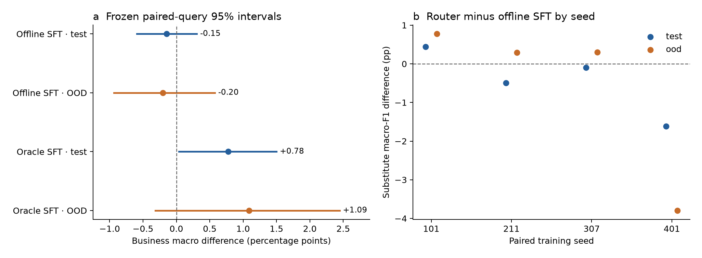
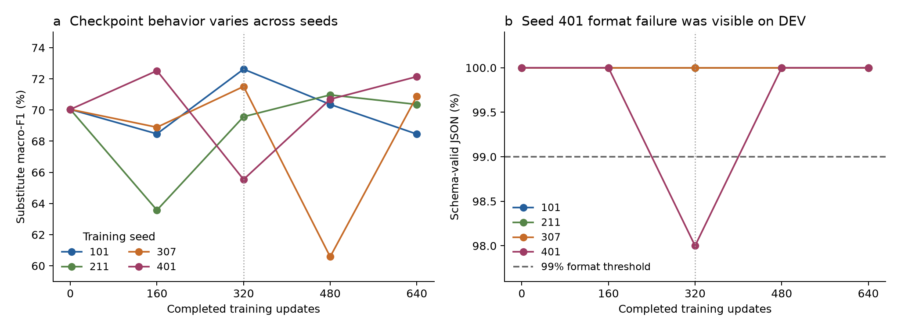

# AOPD 域路由的四种子独立确认实验

2026-10-27。冻结的域路由没有建立相对强 SFT 的质量优势。它相对 offline SFT 的业务宏指标均值在两个独立 split 上略低，置信区间均跨过零；seed401 同时未通过 JSON 合法率门禁。结论来自完整的四组配对训练与双 holdout，未排除失败 seed，也未修改冻结规则。

图 1。左图为业务宏指标差值与预先规定的配对 query bootstrap 95% 区间；区间条件于四个已观察的训练 seed。右图为各 seed 的 substitute macro-F1 差值，不代表新增独立样本。只有 substitute 使用 AOPD，其余任务使用同一 offline adapter。

## 比较问题与冻结条件

本实验检验：仅在 substitute 任务使用 AOPD，是否能在保持其他能力的同时优于 offline SFT，并通过 oracle SFT 对照？路由键只读取请求的任务类型，不读取答案、预测或 grader 输出。

学生为 Qwen3.5-2B 的文本组件。AOPD 使用 step320 初始化和固定 step320 产物；offline SFT 使用固定初始化与 step160/320/480/640 的 FP32 LoRA 因子均值；oracle SFT 使用 step80 初始化与 step480/640 因子均值。每条训练臂完成 640 步，配对 seed 为 101、211、307、401。后处理平均的是 LoRA 因子，不是各 checkpoint 的 BA 权重增量。各配方的初始化和监督不同，因此这是完整配方比较，不能解释为仅改变一个损失函数的消融。

所有训练 Run 与 12 个训练臂完成后才封装 holdout。训练文件 196 项、6.27 GB 的字节数与 SHA256 全部通过独立核验。四个 evaluation Run 全部成功后，才取回并核验 72 个结果文件，再按冻结 grader 重判。

test 包含 search/relevance/substitute 各 1500 个 query 和 500 个数学输入；OOD 包含四类任务各 500 个输入。两个 split 总计 7000 个独立评测输入。各 seed 重复评测同一输入；64,000 条模型回答不等于 64,000 个独立 query。这里的 OOD 是该协议中独立 query split 的名称，不自动证明地域、时间或产品分布外的泛化。

业务宏指标为 search NDCG、relevance macro-F1、substitute macro-F1 的等权均值。采用 5000 次配对 query bootstrap，分类 F1 在每次重采样内从混淆计数重算。验收要求两个 split 都通过相对 offline/oracle 的宏指标区间下界大于零、至少 3/4 正差值 seed、逐域非劣与绝对质量门禁。四个 seed 不足以建立普遍的训练随机性鲁棒性。

## 双 holdout 结果

下表均值按四个 seed 平均。Δ 和 CI 的单位为百分点，均为路由减对应对照。

| 对照 | Split | 对照业务宏指标 | 路由业务宏指标 | Δ | 配对 query 95% CI |
|---|---|---:|---:|---:|---:|
| Offline SFT | test | 67.378% | 67.231% | −0.147 | [−0.592, +0.307] |
| Offline SFT | OOD | 66.325% | 66.122% | −0.202 | [−0.936, +0.577] |
| Oracle SFT | test | 66.453% | 67.231% | +0.778 | [+0.039, +1.500] |
| Oracle SFT | OOD | 65.032% | 66.122% | +1.090 | [−0.315, +2.446] |

相对 offline SFT，search、relevance、math 的输出因路由定义完全相同，宏指标变化全部来自 substitute。substitute macro-F1 在 test 上为 64.149% 对 64.590%，在 OOD 上为 61.377% 对 61.984%。相对 oracle，test 的宏指标区间为正，但 OOD 未复现区间为正，且绝对格式门禁失败；不能据此宣布通过强 SFT 确认。

| 冻结门禁 | test | OOD |
|---|---|---|
| 相对 offline 的宏指标 CI 下界 > 0 | 未通过 | 未通过 |
| 相对 offline 至少 3/4 正差值 seed | 1/4，未通过 | 3/4，通过 |
| 相对 oracle 的宏指标 CI 下界 > 0 | 通过 | 未通过 |
| 所有业务域 −3 pp 非劣 | 通过 | 通过 |
| 数学 −5 pp 非劣 | 通过 | 通过 |
| 每个 seed 的绝对质量与格式门禁 | 未通过 | 未通过 |

绝对门禁的唯一失败项是 seed401 的 substitute JSON 合法率：test 为 1478/1500 = 98.533%，OOD 为 492/500 = 98.400%，均低于冻结的 99%。这里的 `json_valid` 同时要求可解析的 JSON、正确字段集合和允许的值域；substitute 字段只能为 `yes/no`。两处均无输出截断。其他 seed 的 substitute 输出全部通过该门禁。去掉 seed401 或在结果公开后新增 fallback 会改变本次候选，不能作为本次确认的补救。

## DEV 诊断与下一轮方法工作

图 2。仅使用已完成训练中保存的 FP32 DEV 预测，substitute 有 300 个 query。虚线为 99% 格式阈值，竖虚线为本次固定 step320；这些曲线不替代 BF16 的最终候选评估。

seed401 在 step320 的 DEV 上已有 6/300 条值域不合规的 JSON：五条为 `{"substitute":"C"}`，一条为 `{"substitute":"I"}`，均可解析且未截断，但不满足 prompt 明确要求的 `yes/no`。该点 macro-F1 为 65.542%；在 step160/480/640 上格式合法率均为 100%。seed307 的 DEV F1 也从 step320 的 71.510% 降至 step480 的 60.581%，再到 step640 的 70.881%。观察说明固定单 checkpoint 的行为在这些训练轨迹上波动；尚未隔离其数值、训练目标或解码机制的原因。

下一轮先用现有训练产物，比较固定 step320、最终 step640、最后两点因子均值、四点因子均值，并在同一 BF16 DEV 上评估所有四个 seed 与原 SFT 对照。目标是检验后处理能否减少跨 seed 的格式和质量波动；平均是否有益仍是待验证假设。候选选择必须先满足每个 seed 的格式与类别召回门禁。

本次 test/OOD 已被观察。下一轮候选即使在 DEV 上改善，也不能把这两个 split 再称为未见的确认集；新的优势主张需要重新冻结规则与未见的独立数据。

## 执行成本与证据

本次确认训练消耗 38.969 H20·h，evaluation 消耗 7.579 H20·h，共 46.548 H20·h。保留 12 个 trial：四次不支持的 3-H20 请求在分配前以 −80002 结束，其实际分配 GPU·h 为零；后续四次 2-H20 训练和四次 2-H20 evaluation 均成功。峰值分配为 8 H20。成本按持久化 Pod `start_at` 至 `stop_at` 乘以申请卡数核算，不等同于付费账单或有效计算工时。

该数字仅覆盖本次确认。历史开发成本另行保留，部分旧失败 trial 的分配起点仍未闭合；没有等成本优势、吞吐优势或全项目最终成本主张。

- [冻结协议](../../configs/router-confirmation-v1.json)与[分析合同](../../configs/router-confirmation-analysis-v1.json)。
- [完整统计结果](CONFIRMATION_AOPD_DOMAIN_ROUTER.json)与[独立点估计、训练健康和 DEV 诊断](CONFIRMATION_AOPD_DOMAIN_ROUTER_AUDIT.json)。
- [DEV 标签值域诊断与原始文件哈希](ROUTER_SCHEMA_DEV_DIAGNOSTIC.json)。
- [所有 trial 的成本记录](CONFIRMATION_AOPD_DOMAIN_ROUTER_COST.json)与[结果文件采集校验](router-confirmation-collection-audit.json)。
- [冻结分析入口](../../scripts/analyze_aopd_router_confirmation.py)与[图表重现入口](../../scripts/plot_router_confirmation.py)。
