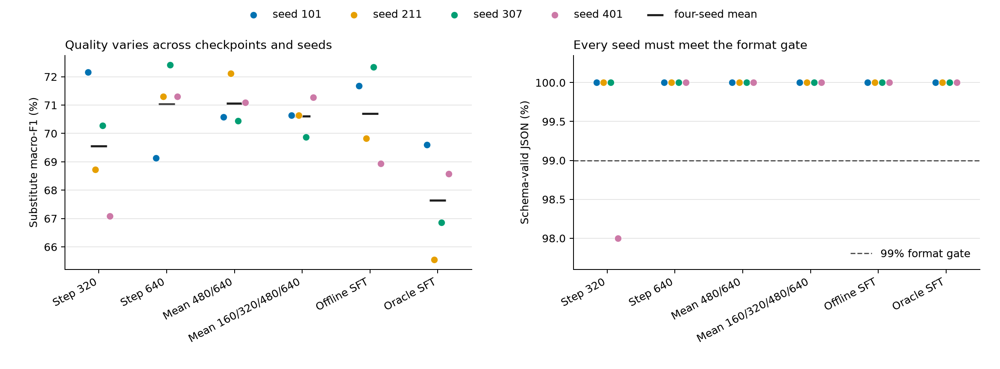

# Checkpoint 后处理的 BF16 DEV 稳定性实验

四种预先规定的 checkpoint 规则中，3 种通过全部四个 seed 的绝对质量门禁。按冻结的 DEV 业务宏指标排序，last2 排名第一；相对 offline SFT 的均值差为 +0.122 个百分点，只有 2/4 个 seed 取得正差值。这是 DEV 选择结果，尚未建立独立确认或成本优势。

图 1。每个彩色点是一个训练 seed 在同一 300 个 substitute query 上的结果；黑短线是四 seed 均值，虚线是预设格式门禁。点间差异不是置信区间，重复评测没有增加独立 query 数。

## 比较问题与方法

本轮检验：复用已完成的 AOPD 训练，固定 step320、固定 step640、最后两点因子均值、四点因子均值能否在所有 seed 上同时保持格式和分类质量？全部规则均预先声明，统一应用于 101、211、307、401；不存在按 seed 选 checkpoint、丢弃 seed 或新增输出 fallback。

学生为 Qwen3.5-2B 文本组件。模型评测使用 BF16；平均产物使用已保存 FP32 LoRA 因子的算术均值，不是 BA 权重增量的均值。每个平均产物已从原始 checkpoint 独立重建并逐张量精确比较，固定产物与两个 SFT 对照的 adapter 文件与配置 SHA256 也已核对。

冻结 DEV 文件有 1400 行。本轮 workload 使用 search/relevance/substitute 各 300 行，math/instruction 各前 100 行，共 1100 个输入。每种 AOPD 规则只评估 substitute；其余域复用同 seed 的 frozen offline SFT 输出。两个 SFT 对照各评估完整 workload；总计 13,600 条回答，来自相同 DEV 输入，不能计为新增独立样本。

验收先检查每个 seed：search NDCG ≥80%，relevance macro-F1 ≥45%，substitute macro-F1 ≥55%，各业务域合法 JSON ≥99%；substitute 两类 recall ≥30%，relevance 四类 recall ≥20%。合法 JSON 同时要求语法、字段集合和值域正确；substitute 仅允许 yes/no。全部 seed 通过后才按三业务指标等权均值排序。DEV 多规则选择不产生确认性显著结论。

## 所有规则与对照

Δ 的单位为百分点；业务宏指标为 search NDCG、relevance macro-F1、substitute macro-F1 的等权均值。

| 全局规则 | 业务宏指标均值 | Δ vs offline | Δ vs oracle | 正差值 seed vs offline | 全 seed 门禁 |
|---|---:|---:|---:|---:|---|
| fixed320 | 69.774% | -0.378 | +2.881 | 1/4 | 未通过 |
| final640 | 70.267% | +0.115 | +3.373 | 3/4 | 通过 |
| last2 | 70.273% | +0.122 | +3.380 | 2/4 | 通过 |
| all4 | 70.124% | -0.028 | +3.231 | 2/4 | 通过 |

| substitute macro-F1 / JSON 合法率 | seed101 | seed211 | seed307 | seed401 |
|---|---:|---:|---:|---:|
| fixed320 | 72.161% / 100.000% | 68.720% / 100.000% | 70.271% / 100.000% | 67.087% / 98.000% |
| final640 | 69.140% / 100.000% | 71.301% / 100.000% | 72.411% / 100.000% | 71.301% / 100.000% |
| last2 | 70.576% / 100.000% | 72.115% / 100.000% | 70.448% / 100.000% | 71.096% / 100.000% |
| all4 | 70.643% / 100.000% | 70.643% / 100.000% | 69.875% / 100.000% | 71.276% / 100.000% |
| offline_sft | 71.672% / 100.000% | 69.829% / 100.000% | 72.342% / 100.000% | 68.933% / 100.000% |
| oracle_sft | 69.608% / 100.000% | 65.550% / 100.000% | 66.856% / 100.000% | 68.572% / 100.000% |

门禁失败项：fixed320/seed401 的 substitute/json_valid 为 0.9800，低于 0.9900。

逐 seed 的类别 support、precision、recall、F1 与全部门禁判断保留在机读结果中。

## 证据允许的结论

在这批 DEV 输入上，final640、last2、all4 均未出现 substitute 值域异常，四个 seed 的 schema 合法率均为 100%。last2 的业务宏指标仅比 final640 高 0.007 个百分点；相对 offline SFT 的提升也没有在所有 seed 上保持同一方向。本轮没有形成值得立即投入新确认实验的稳定质量改善证据，下一步应继续在 DEV 上定位质量差异。

本次是失败确认之后的探索性 DEV 消融。原 test/OOD 已观察，第一次确认的负结果保留；本轮输出不能替代该结果，也不能把原 test/OOD 再用作未见确认集。若要提出修订候选的优势，必须先冻结统一规则，再在未见的独立 query 上完成配对确认。

本轮新增分配成本为 1.849 H20·h，保留 4 个 trial。按 Pod start_at 至 stop_at × 分配卡数计算，不等同于付费账单或有效计算工时。没有新增训练；此前确认的 46.548 H20·h 及历史开发成本单独保留，不能把本轮成本称为全项目总成本。

- [完整独立重判结果](ROUTER_STABILITY_DEV.json)。
- [所有 trial 的分配成本](ROUTER_STABILITY_DEV_COST.json)。
- [精确 adapter 来源与结果采集审计](router-stability-collection-audit.json)。
- [冻结 DEV 规则](../../configs/router-stability-dev-v1.json)。
- [原失败确认](CONFIRMATION_AOPD_DOMAIN_ROUTER.md)。
- [重判入口](../../scripts/analyze_router_stability_dev.py)与[图表入口](../../scripts/write_router_stability_dev_report.py)。
