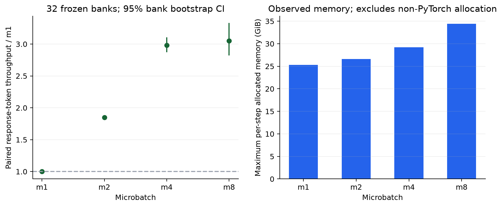
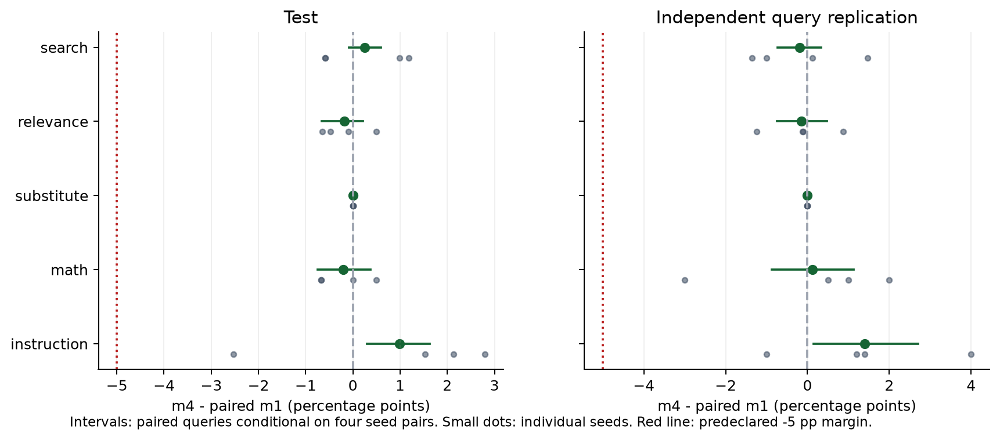
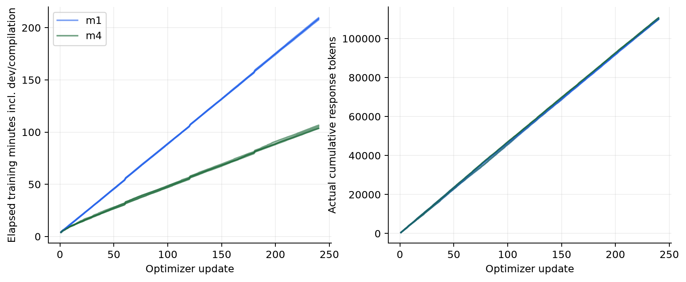
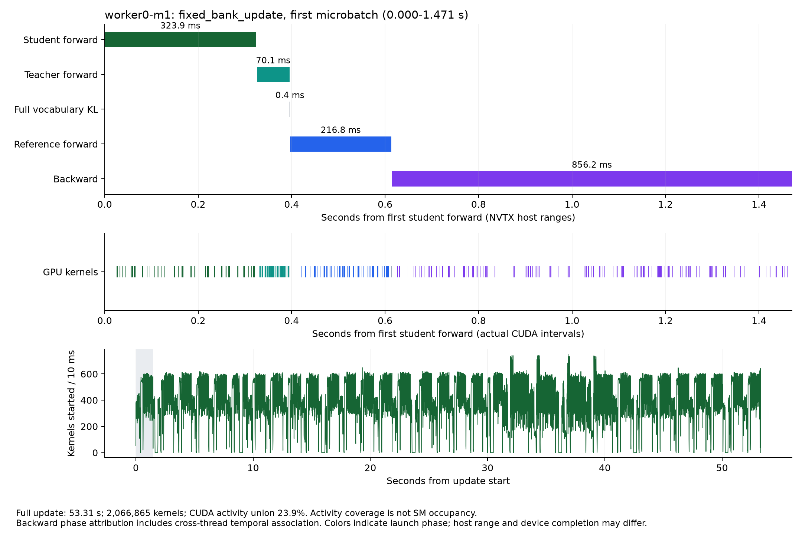
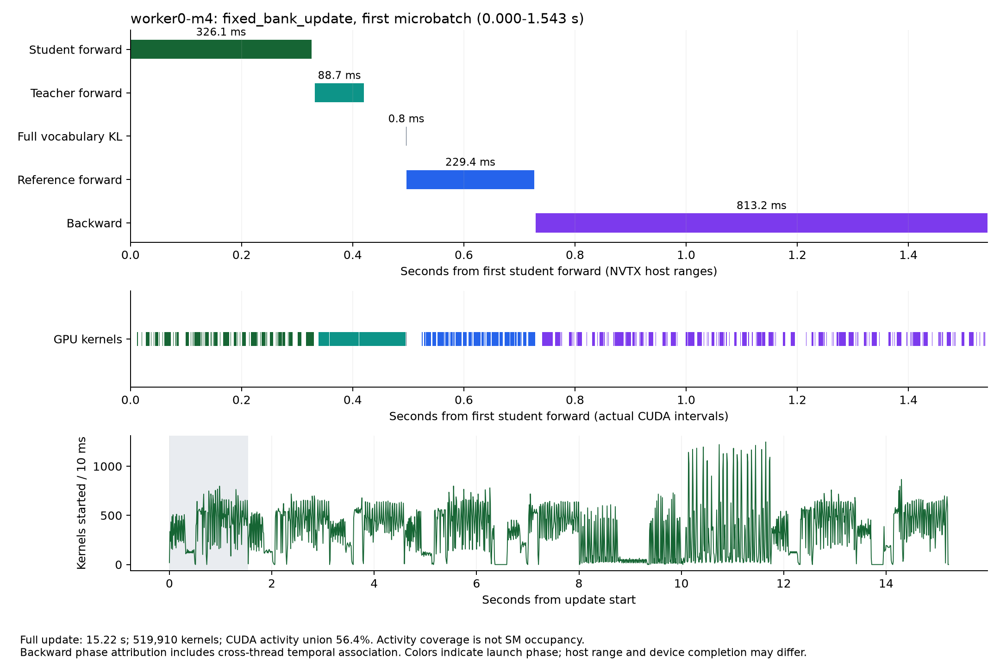

# ServeDistill：扩大实验结果

Qwen3.5-9B → Qwen3.5-2B Full reverse-KL OPD，H20，microbatch 1/2/4/8 的固定轨迹比较，以及 m1/m4 四组配对种子的较长训练。

无 profiler 的 m4 learner 吞吐为 m1 的 **2.98×**，32 bank 配对 bootstrap 95% CI **[2.88, 3.10]**。新测试集和独立 query 复测上的三业务域 −5 pp 非劣效联合判据**全部通过**。这两个结论分别来自固定轨迹计时和实际训练后评测。

非劣效结论只比较 m4 与 m1。逐类复核发现 8 个最终模型在两个 split 的替代品任务上都只预测 `no`，正类召回率为 0；该域保留的是退化的分类器。相关性分类也明显偏向 E/I。执行优化成功不能作为业务模型可用性的证明。

已验收 **8 arms × 240 updates**、**881,401 个有效训练 response token**。本次扩展按 Pod 调度到释放计 **43.6433 H20 GPUh**，峰值 10 卡，全部释放；加上前期质量研究和诊断，项目合计 **104.2664 GPUh**。

## 为什么此前的小数据不够

此前 283 个 response token、一次捕获 update 的百万级 kernel，能帮助定位细碎发射，不能给出稳态性能置信区间，也不能证明训练质量保持。本实验把实际计时重复、独立 workload 数、训练种子和独立评测 query 分开计数。

| 证据 | 本次规模 | 统计单位 |
|---|---:|---|
| 固定轨迹 | 256 prompts、1,024 trajectories、14,375 response tokens | 32 个独立 bank |
| 正式计时 | 384 updates，正式对照前 128 个预热 update | 每 bank 内 3 次取中位数 |
| Nsight 追加 | 4 个预热 update、4 个捕获 update | 代表 bank 的机制解释，排除出性能 CI |
| 较长训练 | 4 seeds × 2 microbatch × 240 updates；61,440 条验收生成轨迹 | 4 对训练种子 |
| Test / replication | 6,600 / 2,200 queries，各 checkpoint 完整评测 | query 配对，绑定四个种子 |

## 固定轨迹性能

每次在计时外恢复同一 adapter、Adam 和 RNG，固定 token、EOS mask、behavior logprob。计时包含完整 learner update 与 CUDA 同步，排除 rollout、状态恢复、CPU 向量导出和 profiler。按 bank 取重复中位数，吞吐估计为总有效 token 除以 bank 中位耗时之和。

| microbatch | response token/s | 相对 m1 / 95% CI | bank update 中位 / P95，s | allocated / reserved 最大值，GiB |
|---|---:|---|---|---|
| 1 | 10.11 | 1.00 / [1.00, 1.00] | 44.37 / 50.25 | 25.33 / 34.75 |
| 2 | 18.68 | 1.85 / [1.83, 1.87] | 23.90 / 28.10 | 26.62 / 34.75 |
| 4 | 30.15 | 2.98 / [2.88, 3.10] | 15.05 / 18.95 | 29.20 / 34.75 |
| 8 | 30.84 | 3.05 / [2.83, 3.32] | 14.95 / 21.87 | 34.39 / 34.75 |



探索性追加比较：m8 相对 m4 的吞吐比为 1.023×，32 bank 配对 95% CI [0.98, 1.08]；allocated 峰值额外增加 5.19 GiB。该比较不是预设主终点；区间包含 1 时，不能确立 m8 有额外稳定收益。

P95 是 bank update 的分布统计，不是 serving 请求 P95。显存是本步骤的 PyTorch 高水位，未包含非 PyTorch 分配。置信区间条件于当前父状态、两个 worker 与该 workload；不代表跨所有硬件和模型。

| prompt 长度四分位 | bank 数 | 用户 prompt 平均长度范围，token | m4/m1 / 95% CI |
|---|---:|---|---|
| 1 | 8 | [89.50, 200.38] | 3.49 / [3.37, 3.61] |
| 2 | 8 | [207.75, 270.75] | 3.07 / [3.01, 3.12] |
| 3 | 8 | [271.25, 355.50] | 2.90 / [2.84, 2.96] |
| 4 | 8 | [364.62, 515.38] | 2.67 / [2.57, 2.76] |

长度按用户 prompt token 数统计，不包含 system 和 chat template；分桶属于较小的条件分析，不能推导所有长上下文场景。

## 四种子训练后的质量

主终点固定 update240；相同种子的 m1/m4 从共同父 adapter/Adam fork，使用相同 prompt schedule。测试集没有用于 checkpoint 选择或调参。下表每个区间保持同一 query 的四个种子输出绑定，再对 query 配对重采样。CI 条件于已观察的四个训练种子，不把 4×query 输出视为更多独立 query。

次级 dev-selected checkpoint 的 8 arm 摘要另存 [secondary-dev-selected.json](secondary-dev-selected.json)。其中 3 个较早 checkpoint 另完成 26,400 条输出，经过完整覆盖和独立重判；其余复用最终 checkpoint。主表和非劣效 CI 始终使用固定 update240，不按 test 结果重选。

共同父 checkpoint 是已经训练过的 update40，并非未训练的 2B 基座。下面的父状态→最终状态变化是描述性的延长训练结果；m4 对 m1 的配对比较才是本次 microbatch 修改的主对照。

| 领域 | Test 父状态，% | Test m1 / m4，% | Replication 父状态，% | Replication m1 / m4，% |
|---|---:|---|---:|---|
| search | 75.26 | 83.58 / 83.83 | 75.15 | 81.61 / 81.42 |
| relevance | 20.94 | 26.75 / 26.57 | 23.12 | 27.58 / 27.43 |
| substitute | 39.15 | 39.32 / 39.32 | 39.78 | 39.47 / 39.47 |
| math | 7.17 | 7.21 / 7.00 | 9.50 | 8.38 / 8.50 |
| instruction | 58.07 | 77.15 / 78.13 | 58.20 | 76.30 / 77.70 |

### Test

| 领域 / 指标 | 独立 query / 指标有效 query | m1 均值，% | m4 均值，% | m4−m1，pp / 95% CI | −5 pp 非劣效 |
|---|---:|---:|---:|---|---|
| search / NDCG | 1500 / 1490 | 83.58 | 83.83 | 0.25 / [-0.09, 0.59] | supported |
| relevance / macro-F1 | 1500 / 1500 | 26.75 | 26.57 | -0.18 / [-0.66, 0.21] | supported |
| substitute / macro-F1 | 1500 / 1500 | 39.32 | 39.32 | 0.00 / [0.00, 0.00] | supported |
| math / success | 600 / 600 | 7.21 | 7.00 | -0.21 / [-0.75, 0.38] | supported |
| instruction / success | 1500 / 1500 | 77.15 | 78.13 | 0.98 / [0.30, 1.63] | supported |

| 领域 | seed17 / 29 / 43 / 71 的配对差，pp | 探索性 seed bootstrap 95% CI，pp |
|---|---|---|
| search | -0.58 / -0.58 / 0.99 / 1.18 | [-0.58, 1.09] |
| relevance | -0.65 / 0.49 / -0.09 / -0.48 | [-0.56, 0.25] |
| substitute | 0.00 / 0.00 / 0.00 / 0.00 | [0.00, 0.00] |
| math | 0.50 / -0.67 / 0.00 / -0.67 | [-0.67, 0.25] |
| instruction | 1.53 / -2.53 / 2.13 / 2.80 | [-1.37, 2.48] |

| 领域 / 辅助指标 | m1 / m4，% | 配对差，pp / 95% CI |
|---|---|---|
| search / json_valid | 95.50 / 95.87 | 0.37 / [-0.02, 0.73] |
| search / truncated | 0.00 / 0.02 | 0.02 / [0.00, 0.07] |
| search / mrr | 73.87 / 73.97 | 0.10 / [-0.25, 0.44] |
| relevance / json_valid | 100.00 / 100.00 | 0.00 / [0.00, 0.00] |
| relevance / truncated | 0.00 / 0.00 | 0.00 / [0.00, 0.00] |
| substitute / json_valid | 100.00 / 100.00 | 0.00 / [0.00, 0.00] |
| substitute / truncated | 0.00 / 0.00 | 0.00 / [0.00, 0.00] |
| math / json_valid | 99.79 / 99.83 | 0.04 / [0.00, 0.12] |
| math / truncated | 0.21 / 0.17 | -0.04 / [-0.12, 0.00] |
| instruction / json_valid | 100.00 / 100.00 | 0.00 / [0.00, 0.00] |
| instruction / truncated | 0.00 / 0.00 | 0.00 / [0.00, 0.00] |

### 独立 query replication

| 领域 / 指标 | 独立 query / 指标有效 query | m1 均值，% | m4 均值，% | m4−m1，pp / 95% CI | −5 pp 非劣效 |
|---|---:|---:|---:|---|---|
| search / NDCG | 500 / 494 | 81.61 | 81.42 | -0.19 / [-0.73, 0.33] | supported |
| relevance / macro-F1 | 500 / 500 | 27.58 | 27.43 | -0.15 / [-0.75, 0.47] | supported |
| substitute / macro-F1 | 500 / 500 | 39.47 | 39.47 | 0.00 / [0.00, 0.00] | supported |
| math / success | 200 / 200 | 8.38 | 8.50 | 0.12 / [-0.87, 1.12] | supported |
| instruction / success | 500 / 500 | 76.30 | 77.70 | 1.40 / [0.15, 2.70] | supported |

| 领域 | seed17 / 29 / 43 / 71 的配对差，pp | 探索性 seed bootstrap 95% CI，pp |
|---|---|---|
| search | -1.00 / -1.35 / 1.46 / 0.11 | [-1.18, 0.85] |
| relevance | -1.24 / -0.13 / -0.11 / 0.88 | [-0.96, 0.63] |
| substitute | 0.00 / 0.00 / 0.00 / 0.00 | [0.00, 0.00] |
| math | 2.00 / -3.00 / 0.50 / 1.00 | [-2.00, 1.62] |
| instruction | 1.40 / -1.00 / 1.20 / 4.00 | [-0.40, 3.30] |

| 领域 / 辅助指标 | m1 / m4，% | 配对差，pp / 95% CI |
|---|---|---|
| search / json_valid | 94.65 / 94.35 | -0.30 / [-0.85, 0.25] |
| search / truncated | 0.00 / 0.00 | 0.00 / [0.00, 0.00] |
| search / mrr | 70.36 / 70.16 | -0.20 / [-0.77, 0.37] |
| relevance / json_valid | 100.00 / 100.00 | 0.00 / [0.00, 0.00] |
| relevance / truncated | 0.00 / 0.00 | 0.00 / [0.00, 0.00] |
| substitute / json_valid | 100.00 / 100.00 | 0.00 / [0.00, 0.00] |
| substitute / truncated | 0.00 / 0.00 | 0.00 / [0.00, 0.00] |
| math / json_valid | 100.00 / 100.00 | 0.00 / [0.00, 0.00] |
| math / truncated | 0.00 / 0.00 | 0.00 / [0.00, 0.00] |
| instruction / json_valid | 100.00 / 100.00 | 0.00 / [0.00, 0.00] |
| instruction / truncated | 0.00 / 0.00 | 0.00 / [0.00, 0.00] |



这些是 pointwise CI；三业务域联合结论要求每域分别通过。−5 pp 是预先声明的可接受退化界限，通过并不表示逐位等价、零退化或 OPD 优于 SFT。四种子经验 bootstrap 只作探索，不能确立跨训练随机性的普适结论。replication 使用官方 test 的独立 query，未人为制造分布偏移，不声称真实 OOD。

### 类别退化与绝对质量

替代品域的 [逐类复核](classification-audit.json)显示，8 个最终 arm 的预测均为常数 `no`。下表每个 query 数是单个 split 的独立数量，没有把重复 checkpoint 输出增加到独立样本量中。

| Split | 独立 query / 正类支持 | 每 arm 预测 yes | 正类召回率，% | m1 / m4 macro-F1，% | 常数多数类 macro-F1，% |
|---|---|---:|---:|---|---:|
| Test | 1500 / 528 | 0 | 0.00 | 39.32 / 39.32 | 39.32 |
| Replication | 500 / 174 | 0 | 0.00 | 39.47 / 39.47 | 39.47 |

因此 substitute 的配对差和 bootstrap CI 都为零，来自相同的常数预测；不能解释成有用能力得到保持。相关性分类的逐类召回也显示 S/C 类薄弱，下面是四种子均值：

| Split / 类别 | 标签支持 | m1 recall，% | m4 recall，% |
|---|---:|---:|---:|
| Test / E | 654 | 82.30 | 83.30 |
| Test / S | 527 | 1.00 | 0.71 |
| Test / C | 81 | 0.62 | 0.31 |
| Test / I | 238 | 58.93 | 58.30 |
| Replication / E | 230 | 85.00 | 85.43 |
| Replication / S | 170 | 0.74 | 0.29 |
| Replication / C | 22 | 0.00 | 0.00 |
| Replication / I | 78 | 60.90 | 61.22 |

该追加分析是描述性诊断，冻结的质量终点与 −5 pp 判据保持不变。当前证据足以支持本 workload 的 microbatch 执行选择，不足以支持 OPD 优于 SFT、完整业务能力保持或生产上线。

## 实际训练工作与端到端时间

| arm | prompt visits / unique prompts | 有效 response tokens | 平均 response 长度 / 截断，% | train / final eval，min |
|---|---|---:|---|---|
| full_kl_m1_seed17 | 1,920 / 1,790 | 109,851 | 14.30 / 0.04 | 208.73 / 19.13 |
| full_kl_m4_seed17 | 1,920 / 1,790 | 110,493 | 14.39 / 0.04 | 104.91 / 20.53 |
| full_kl_m1_seed29 | 1,920 / 1,794 | 109,850 | 14.30 / 0.00 | 209.80 / 18.87 |
| full_kl_m4_seed29 | 1,920 / 1,794 | 110,447 | 14.38 / 0.04 | 107.77 / 18.89 |
| full_kl_m1_seed43 | 1,920 / 1,773 | 109,786 | 14.30 / 0.01 | 209.84 / 18.30 |
| full_kl_m4_seed43 | 1,920 / 1,773 | 109,998 | 14.32 / 0.00 | 106.45 / 19.54 |
| full_kl_m1_seed71 | 1,920 / 1,801 | 110,335 | 14.37 / 0.03 | 210.76 / 18.37 |
| full_kl_m4_seed71 | 1,920 / 1,801 | 110,641 | 14.41 / 0.03 | 104.81 / 20.30 |

14,000 条是训练池规模；实际四对种子共访问 5,776 个不同 prompt。每 arm 1,920 次 prompt visit，成对 arm 共享 schedule。实际 response 长度可随 on-policy 参数轨迹改变，端到端时间比包含 rollout、形状编译、dev 评估和 checkpoint，不能与固定轨迹 learner 计时混用。

相同 240 updates 下，四个种子 train 阶段的 m1/m4 时间比分别为 1.99 / 1.95 / 1.97 / 2.01；四 arm 时间总和之比为 1.98×。这是观察到的完整训练时长比，排除 final eval 和外层环境准备；没有为四种子声明稳态执行 CI，也不假设实际生成 token 完全相同。



## 数值与运行验收

8 arms 的概率门禁、240 次非零更新、Teacher 冻结检查、完整 step 序列通过；父 adapter/Adam/RNG 指纹一致，评测覆盖和 input hash 通过本地独立重判。
执行关键源码、配置与数据的 worker hash 与公开文件逐项一致；后续分析、绘图、测试和协议说明的差异保留在 source-comparison.json。
概率 tolerance 沿用父实验的 0.15；实际性能 / 训练最大误差为 8.87e-05 / 0.000113，报告实际误差而非只报告通过。Teacher 为 requires_grad=False，冻结指纹检查每个命名参数的前 32 个元素，未逐位 hash 完整 Teacher。
原生 Teacher 的 batch/padding 路径和累积顺序发生变化，post-clip 梯度相对 L2 与参数 delta 差异保留在 validation.json。

原始 FP32 长向量 cosine 对相同向量出现 >1 的非法值；该字段不用于数值等价结论。独立固定 Teacher、四序列的 FP64 归约与原始 FP32 字段分开记录。这是 post-clip 梯度检查，未保存完整逐 token 跨 microbatch logprob 差，也没有覆盖所有 bank 的 pre-clip 向量一致性。

| microbatch 对 m1 | 原生 post-clip 梯度相对 L2，中位 / 最大，% | 参数 update 相对 L2，中位 / 最大，% |
|---|---|---|
| 2 | 2.87 / 8.23 | 1.50 / 4.08 |
| 4 | 3.02 / 10.96 | 1.56 / 4.89 |
| 8 | 3.45 / 10.47 | 1.71 / 4.58 |

上表每个 microbatch 含 32 bank；相对 L2 仍是原生 FP32 归约记录，仅描述实际差异，不是 FP64 精度证书，也不推出训练轨迹等价。

独立四序列 FP64 检查：cosine=0.999999999934，post-clip 梯度相对 L2=1.15e-05，参数 update 相对 L2=2.01e-05。仅对应保存的固定 Teacher 小片段，不能替代原生全 bank 数值差。

## 代表 Nsight 窗口

| 捕获 | 实际 kernel 数 | 带观测完整 update，s | CUDA 活动区间并集，s |
|---|---:|---:|---:|
| worker0-m1 | 2,066,865 | 53.31 | 12.72 |
| worker0-m4 | 519,910 | 15.22 | 8.59 |
| worker1-m1 | 2,163,697 | 55.58 | 14.80 |
| worker1-m4 | 543,229 | 17.37 | 10.67 |

### worker0-m1：第一个 learner microbatch

捕获 `fixed_bank_update` 的 0.000–1.471 s，下表是主机 NVTX 范围，CUDA 完成时刻另见实际 kernel 时间线。

| 阶段 | 主机范围，ms |
|---|---:|
| learner_forward | 323.91 |
| teacher_forward | 70.06 |
| full_vocabulary_kl | 0.41 |
| reference_forward | 216.83 |
| backward | 856.24 |



### worker0-m4：第一个 learner microbatch

捕获 `fixed_bank_update` 的 0.000–1.543 s，下表是主机 NVTX 范围，CUDA 完成时刻另见实际 kernel 时间线。

| 阶段 | 主机范围，ms |
|---|---:|
| learner_forward | 326.10 |
| teacher_forward | 88.75 |
| full_vocabulary_kl | 0.83 |
| reference_forward | 229.39 |
| backward | 813.18 |



Student FP32/PyTorch fallback 和 checkpoint 重算产生的细碎发射，应结合 CUDA launch correlation 与 NVTX 观察；Teacher BF16/FLA 与 Student 的路径不同。显式 Full-KL 范围不包含全部 vocabulary projection / entropy 成本，这些还位于 forward 中。Reference 是关闭 adapter 后的监控 forward。

Kernel 通过 runtime correlation ID 同时约束进程关联，autograd 跨线程发射保留 cross_thread_temporal 标记。CUDA 区间并集是活动覆盖，不能当作 SM occupancy 或 HBM 利用率。带观测窗口时间不参与无观测吞吐 CI；单个 bank 的 trace 也不能冒充 32 bank 的分布。

microbatch 从 1 提至 4，使 32 条序列的 learner 循环从 32 次降到 8 次，optimizer 更新次数保持一次。活跃 logits/activation 和 padding 随 batch 增长；单份 FP32 response logits 按 4×B×Tresponse×248,320 bytes 估算；这是 response 范围的张量规模，完整 forward 还投影 prompt 位置，不能当成总 activation 或进程显存。group_size、prompts_per_step 控制轨迹预算，rollout_batch 控制生成批次；max_new_tokens 只是上限，实际 EOS 长度和截断率必须同时查看。本次只变 microbatch，没有从这些机制推断其他参数的未测收益。

观测方法与复算练习：[OBSERVATION_GUIDE.md](OBSERVATION_GUIDE.md)。包含代表窗口的阅读顺序、CUDA correlation 边界、token loss 权重、response logits 规模公式和五项已保存证据练习。

## 数据、执行与复现

ESCI revision `7916cdf6ab75a462e77f20ab40428a10923998d5`；排除旧 3,300 个 query group 和 5,500 个 input。新 split 之间 query/input overlap=0，train/test 仍共享 359 个商品 ID。
搜索与分类使用独立官方标签，GSM8K 和指令是有限任务族；数据规模增加不自动扩大业务外推边界。

执行路径保持 Student FP32/PyTorch DeltaNet、Teacher BF16/FLA、LoRA r=16、Full reverse KL、token aggregation、lr=2e-5、clip=1、8 prompts×4 completions/update、rollout batch=4、max_new_tokens=128。BF16 部署评测与 FP32 训练分别记录；没有同时修改精度或融合 kernel。

CPU 验证：完整 suite 日志中的 50 项测试通过，但执行工具因 `/proc/.../task/.../comm` 的 sandbox 写限制返回非零，不计作完整 shell 验证成功。后续终态、评测覆盖、生成轨迹、token ledger 与 runtime 合同的 5 项检查独立退出 0；语法与 diff 检查通过。这些 CPU 检查与本报告的实际 GPU 产物验收分别记录。

协议：[PROTOCOL.md](PROTOCOL.md)。统计入口：[analyze_expanded.py](../../scripts/analyze_expanded.py)、[expanded_statistics.py](../../servedistill/expanded_statistics.py)。

```bash
python scripts/analyze_expanded.py \
  --performance reports/expanded/raw/performance-v1 \
  --training reports/expanded/raw/training-v1 \
  --data data_expanded --output reports/expanded
python scripts/plot_expanded.py --statistics reports/expanded \
  --training reports/expanded/raw/training-v1
python scripts/write_expanded_report.py --statistics reports/expanded --data data_expanded
```

原始输出、checkpoint、trace 在本地 raw/ 和持久化存储保留；公开证据排除生成文本、内部资源标识与绝对路径。性能原始计时、训练 steps、task metrics 和文件 hashes 支持独立复核。

## 成本边界

| 分配 | 调度至释放 GPUh |
|---|---:|
| performance（2 卡） | 5.7967 |
| training（8 卡） | 37.8467 |
| 扩展合计 | 43.6433 |
| 原研究 + 原观测 + 扩展 | 104.2664 |

计入环境准备、形状编译、评估、等待和释放；脚本名义上限 56 GPUh 不含平台开销。未提供单价，货币成本为 GPUh × 实际单价。没有从训练 trace 推导线上 P95、SM occupancy、HBM 带宽或生产收益。
