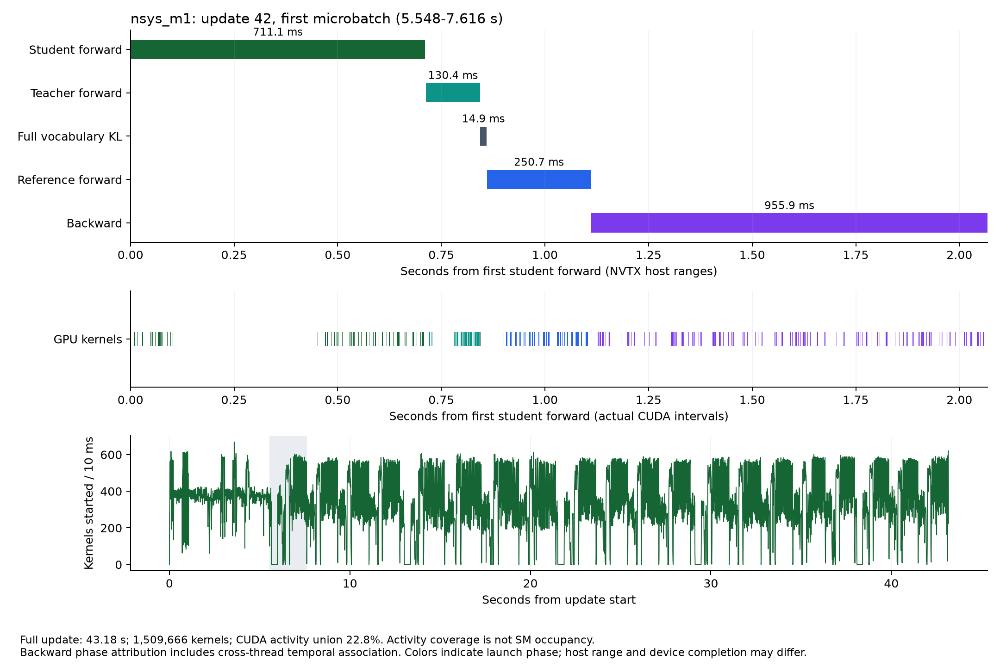
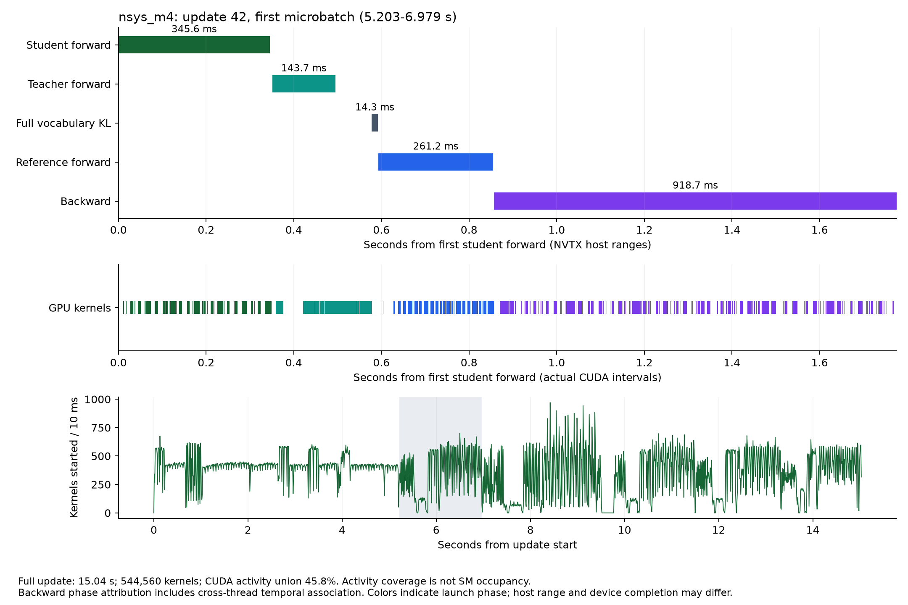

# ServeDistill：H20 训练观测与参数影响

观测对象：Qwen3.5-9B → Qwen3.5-2B，Full reverse-KL OPD，单 H20。从已验收的 seed 17 / update 40 checkpoint 恢复 adapter、Adam 和 RNG，完整运行 update 41 作为预热，只捕获 update 42。这是一段训练诊断，不增加模型质量评测证据。

## 已确认的瓶颈线索

第二轮 microbatch 1→4 将 kernel 数减少 **63.9%**、捕获窗口从 **36.34 s 降到 15.04 s**，以进程峰值 allocated 显存增加 **2.30 GiB** 为代价；计时和数值边界见下方对照。

首轮 `nsys_m1` 的 update 42 为 **43.177 s、1,509,666 个 CUDA kernel**；kernel/memcpy/memset 的区间并集为 **9.837 s，覆盖 22.8% 的更新窗口**。仅 `cudaLaunchKernel` 就有 1,373,013 次调用，累计主机 API 时间 8.613 s。`elementwise_kernel` 为 672,260 次、平均 2.675 μs；`vectorized_elementwise_kernel` 为 514,125 次、平均 1.715 μs。

这些证据支持先检查细碎算子、Python/框架调度、发射间隙及小 microbatch 重复工作。CUDA 活动覆盖率不是 SM occupancy、Tensor Core 使用率或 HBM 带宽利用率；API 累加时间也不是可直接相减的独立关键路径时间。不能把没有 kernel 的整段时间全部归因于 Python。

Student 使用 `float32_torch`：FP32 权重、原生 PyTorch DeltaNet 与卷积 fallback；Teacher 冻结、BF16，使用已安装的 FLA。两者执行路径不同，不能根据 2B/9B 的参数量直接预测耗时。Reference 在同一 Student 上临时禁用 adapter，没有另放一份 2B 模型。

## 工具检查及边界

| 项目 | 实际检查 | 能回答的问题 |
|---|---|---|
| GPU | 1× NVIDIA H20；CUDA 12.9；PyTorch 2.9.1 | 本次硬件与运行时 |
| 模型实现 | Transformers 5.2.0、PEFT 0.18.1、FLA 0.4.1；causal-conv1d 缺失 | 精度和 fallback 路径 |
| Nsight Systems | 2026.1.1.204；CUDA/NVTX 实际采集成功 | CPU 提交与 GPU 完成的时间关系 |
| CPU sampling | 非 root、`perf_event_paranoid=2`；process-tree 环境检查 OK，system-wide Fail | 本轮关闭 sampling/context switches；没有采样调用栈 |
| PyTorch profiler | CPU/CUDA activities 可用 | 对应算子、输入 shape 和 autograd 事件 |
| Nsight Compute | `ncu` 未找到 | 本轮没有硬件计数器或 Roofline 结论 |
| nvidia-smi | 200 ms 周期记录利用率、显存、功耗与 SM 时钟 | 粗粒度状态；无法解释几微秒的 kernel |

Nsight CLI 从 NVIDIA 官方仓库下载，包 SHA256 为 `37a1cb9b12cdbc9c40a8cb42e58b05a141e44c63c800cac435cb8e43256e0780`；只解包到任务本地目录，不要求 root 安装。完整工具输出和 trace 保存在本地 `raw/`，不提交内部路径或资源信息。

## 代表片段：第一个 learner microbatch

首轮 trace 的 **5.548–7.616 s**，依次经过 Student → Teacher → Full-KL → Reference → Backward。



| NVTX 主机范围 | 该 microbatch 主机时间 | 整步对应范围累计主机时间 | 整步关联 kernel 累计设备时间 |
|---|---:|---:|---:|
| Student forward | 711.1 ms | 9.802 s | 1.604 s |
| Teacher forward | 130.4 ms | 2.039 s | 1.021 s |
| Full vocabulary KL | 14.9 ms | 0.338 s | 0.005 s |
| Reference forward | 250.7 ms | 5.269 s | 1.519 s |
| Backward | 955.9 ms | 19.973 s | 3.841 s |

读图顺序：

1. 顶部是 Python/NVTX 范围，标出这段代码在主机上持续多久；中间是实际 CUDA kernel 时间。主机范围不自动等于 GPU 时间，CUDA 提交是异步的。
2. Student 和 Backward 的范围较长、kernel 较细碎。`float32_torch` 的 DeltaNet 实现及 gradient checkpointing 是应优先核查的实现入口。Backward 包含 checkpoint 重算，不能全部理解为权重梯度矩阵乘。
3. Teacher 虽然更大，这段 BF16/FLA 路径更短。Full-KL 显式范围本身很短，但 vocabulary projection、entropy、logsumexp 位于 forward 范围；不能由 14.9 ms 推断“全词表监督总成本只有这么多”。
4. Reference 主要承担偏离基座的监控；该 Full-KL objective 没有把 reference KL 加入训练 loss。可考虑降低监控频率，但需要保留漂移报警语义。
5. 最后一幅图统计每 10 ms 开始的 kernel 数，灰带定位选中的 microbatch。发射密度和活动覆盖共同用于判断碎片化，不能替代硬件计数器。

归因方法：SQLite 中用 CUDA runtime correlation ID **同时约束进程 ID**，把 kernel 关联到发射 API，再映射到 NVTX 范围。Backward 的大部分 kernel 来自 autograd 工作线程，与主线程的 NVTX thread ID 不同：它们单独标为 `backward_cross_thread_temporal`，这里的 3.841 s 包含该时间关联；没有伪装成严格的同线程包含关系。CSV 保留该标记供复核。

## 第二轮：microbatch 实测对照与观测开销

第二轮六个 case 全部退出 0；Nsight 两种 microbatch 使用同一组采集参数。两者的 update 42 都是 20 条序列、283 个有效 response token，样本 ID、token 和 mask hash 相同。

| 指标 | microbatch 1 | microbatch 4 |
|---|---:|---:|
| 捕获的 update 主机时间 | 36.341 s | 15.039 s |
| 实际 CUDA kernel 数 | 1,509,666 | 544,560 |
| kernel/memcpy/memset 活动区间并集 | 9.803 s / 27.0% | 6.882 s / 45.8% |
| `cudaLaunchKernel` 次数 | 1,373,013 | 482,526 |
| `cudaLaunchKernel` 累计主机 API 时间 | 6.638 s | 3.114 s |
| 进程峰值 PyTorch allocated 显存 | 24.809 GiB | 27.107 GiB |
| rollout/recompute 最大 logprob 误差 | 6.70e-5 | 4.67e-5 |
| 裁剪前 gradient norm | 12.99608 | 12.81785 |
| 参数 delta L2 | 0.01871338 | 0.01870626 |
| Full-KL loss | 0.3332601 | 0.3354802 |

Kernel 数减少 **63.9%**，捕获窗口时间为原来的 **41.4%**，但 rollout 未加速：优化发生在 learner 的 20 次 → 5 次 microbatch 循环。各 NVTX 主机范围如下，范围之外还包括 Python 校验、同步、度量等工作：

| 范围 | microbatch 1 / s | microbatch 4 / s |
|---|---:|---:|
| `rollout` | 4.783 | 5.195 |
| `learner_forward` | 7.665 | 2.144 |
| `teacher_forward` | 1.697 | 0.793 |
| `full_vocabulary_kl` | 0.238 | 0.078 |
| `reference_forward` | 4.450 | 1.420 |
| `backward` | 17.276 | 4.845 |
| `optimizer` | 0.012 | 0.013 |



显存是整个 continuation 进程从加载以来的高水位，不是 update 42 的独立增量，也不是 nvidia-smi 的 reserved/全设备占用。Teacher、Student 和预热都包括在内。

**数值边界：** 两组均恢复相同 update 40 指纹且通过概率门禁，但各自 update 41 使用不同 microbatch；因此 update 42 的参数不能保证逐位一致。Teacher BF16 的 batch/padding 路径、累积顺序及预热更新均可能参与数值变化。本次 gradient norm 差约 −1.37%、loss 差约 +0.67%；当前 trace 不能分离每个因素的贡献。结论是发射粒度改善且本轮合同通过，不能宣称严格等价或质量保持。

**计时边界：** warm 无 profiler m1 update 为 28.663 s；Nsight m1 为 36.341 s，单次相对差约 +26.8%，仍含运行顺序和频率波动。m4 的首个无 profiler case 为 54.466 s，后续 Nsight m4 为 15.039 s；shape/编译冷启动明显混入。没有 warmed 无 profiler m4 的重复分布，所以 **36.34/15.04≈2.42× 是本次带观测窗口的时间比，不是稳态训练加速承诺**。

## PyTorch 短窗口：从时间线回到 shape

第二轮只捕获第一个 m4 learner microbatch 的 forward → backward，成功导出 231.4 MB Chrome trace，包含 **626,070 个事件、318,632 个 CPU op、63,612 个实际 CUDA kernel**。仅对 `cat=kernel` 求和得 0.924 s；CPU op 的 inclusive duration 和 annotation 行都不能跨层累加。

| 实际记录 | shape / 含义 |
|---|---|
| Student MLP 的 `aten::mm` | `[1088,2048] × [2048,6144]`；1088=4×272，四条序列的 token 展平 |
| Teacher MLP 的 `aten::mm` | `[1300,4096] × [4096,12288]`；1300=4×325，Teacher prompt/template 较长 |
| Student vocabulary projection | `[120,2048] × [2048,248320]`；120=4×30，只输出 response 预测位置 |
| DeltaNet 分块中间张量 | `[4,16,5,64,64]`；该 shape 的 `aten::as_strided` 14,148 次、`aten::select` 8,298 次 |
| Teacher FLA | `ChunkGatedDeltaRuleFunction` 的 `[4,325,32,128]` 输入实际可见 |
| 未安装 causal-conv1d | 原生 `_conv_depthwise2d` 路径在 shape 表中可见 |

以实际 V=248,320、B=4、response width=30 计算，单份 FP32 logits 是 **113.7 MiB**。KL/entropy 的多个中间张量、模型 activation 和缓存另算；缩短 response 或增大 batch 对显存的影响应按真实 shape 算。

一个容易误读的例子：原始 trace 的 `gpu_user_annotation/backward` 只有 **87.522 μs**，CPU `user_annotation/backward` 为 **1.135 s**。这不能说明反传只用了 87 μs：autograd 工作线程的 kernel 不能靠主线程 annotation 名字完整归属。应展开真实 `kernel` 与 `cuda_runtime`/flow correlation；Nsight 分析已单独保留 cross-thread temporal 标记。算子表中的重复 scope/kernel/op 行不是互斥的时间占比。

整个 torch case 的 update 为 50.723 s，其中包含 profiler 停止、后处理与导出成本；采集窗口只覆盖一个 microbatch，不包含 rollout 和 optimizer。整步 shapes 首轮超过 240 s，第二轮短窗口 case 成功结束于 82.085 s（含加载和两步训练）。不把 profiler 数字用作无观测吞吐基线。

```bash
python scripts/analyze_torch_profile.py \
  --input /path/torch_m4/observation/torch-trace.json \
  --output /path/analysis/torch_m4-summary.json
```

以上原始事件计数与 shape 可由 [PyTorch 摘要](v2/torch_m4-summary.json) 复核；[第二轮完整测量](v2/measurements.json) 保存各 case 合同和主机范围，[m1](v2/nsys_m1-cuda-summary.json) / [m4](v2/nsys_m4-cuda-summary.json) 保存实际 CUDA 区间分析。

## 如何跟踪与复现

安装画图依赖：`pip install -e '.[profiling]'`。Nsight CLI 另行安装，使用与本次相同或兼容的版本。

代码入口：`servedistill/observation.py` 管理窗口、NVTX、PyTorch profiler 和主机范围；`servedistill/train.py` 标记各训练阶段；`servedistill/runtime.py` 决定精度、DeltaNet、response-only logits 与 checkpointing；`scripts/profile_training.py` 先校验原 checkpoint 配置，再在诊断副本中覆盖 microbatch；`scripts/analyze_profile.py` 只读 SQLite、计算区间并集和发射关联；`scripts/plot_profile.py` 由真实区间生成 PNG/SVG/PDF。

```bash
# 工具与权限检查
nvidia-smi -q
nsys --version
nsys status --environment
command -v ncu
python -c 'import torch; print(torch.__version__, torch.version.cuda, torch.profiler.supported_activities())'

# 先运行同样的无 profiler continuation，预热模型和 shape 编译缓存。
python scripts/profile_training.py \
  --student /path/student/model --teacher /path/teacher/model \
  --data data_search --config configs/matrix/full_kl_seed17.json \
  --resume /path/checkpoint-0040 --output /path/baseline_m1 \
  --backend none --first-update 42 --last-update 42 --microbatch 1

# 只捕获 update 42；output 必须是新目录。
nsys profile --trace=cuda,nvtx,osrt \
  --capture-range=cudaProfilerApi --capture-range-end=stop \
  --sample=none --cpuctxsw=none --force-overwrite=true \
  --output=/path/nsys_m1/capture \
  python scripts/profile_training.py \
  --student /path/student/model --teacher /path/teacher/model \
  --data data_search --config configs/matrix/full_kl_seed17.json \
  --resume /path/checkpoint-0040 --output /path/nsys_m1/application \
  --backend nsys --first-update 42 --last-update 42 --microbatch 1

nsys stats --report=cuda_gpu_kern_sum,cuda_api_sum,nvtx_sum,cuda_gpu_mem_time_sum \
  --format=csv /path/nsys_m1/capture.nsys-rep
nsys export --type=sqlite --output=/path/nsys_m1/capture.sqlite \
  /path/nsys_m1/capture.nsys-rep

# PyTorch：只捕获第一个 microbatch 的 forward → backward。
python scripts/profile_training.py \
  --student /path/student/model --teacher /path/teacher/model \
  --data data_search --config configs/matrix/full_kl_seed17.json \
  --resume /path/checkpoint-0040 --output /path/torch_m4 \
  --backend torch --first-update 42 --last-update 42 --microbatch 4 \
  --record-shapes --torch-first-microbatch
```

GUI 打开 `capture.nsys-rep`，搜索 `update_42`，展开 NVTX / CUDA API / GPU stream，对齐选中的 microbatch，再从 kernel 的 correlation 信息追溯 launch。PyTorch `torch-trace.json` 可用 Chrome trace viewer 或本地 Perfetto UI 打开；先查 `learner_forward` 和 `backward`，再查看 `aten::*`、input dims 与 CUDA kernel。含内部路径的原始 trace 应在本地查看。

`profile_worker.py` 自动整理 case 目录；`analyze_profile.py` 读取其中的 `observation/host-spans.json`、`metrics.jsonl`、`last-rollout-contract.json` 和 `capture.sqlite`。当前分析脚本针对 `update_42`，更换窗口需同步修改范围筛选。手工运行时，需把 `application/observation` 和 `application/train` 中这些文件整理到同样的布局，再运行：

```bash
python scripts/analyze_profile.py --input /path/cases --output /path/analysis
python scripts/plot_profile.py --input /path/analysis --case nsys_m1
```

## 参数如何影响效果

本轮只做 microbatch 的实测对照，其余是结合实现给出的机制解释，未测项目不列为性能增益。

| 参数 / 路径 | 当前值 | 对执行的影响 | 代价及应同时看的指标 |
|---|---|---|---|
| `microbatch` | 1；诊断对照 4 | 20 条序列由 20 次变为 5 次 forward/backward；optimizer 仍每 update 执行一次，减少重复发射 | 活跃 logits/activation 显存增加；batch padding、Teacher BF16 舍入和归约顺序改变；核验 token/mask、概率、梯度和峰值显存 |
| `prompts_per_step × group_size` | 5×4=20 | 决定一次更新的轨迹数，和 learner microbatch 是不同轴 | 更多轨迹增加三个阶段的工作；group size 更大不保证能力增益；本实现即使 Full-KL 也计算 GRPO 监控，要求每组至少 2 条 |
| `rollout_batch` | 4 | 控制生成阶段 batch；可能减少重复 prefill/发射并提高 GPU 并行度 | cache 和 scores 占显存；不同终止长度造成 padding/长尾；随机数使用顺序可能变化 |
| `max_new_tokens` | 128 | 控制最长生成步数、response logits 和监督 token 数 | 上限不等于实际长度；过短截断 JSON/答案，损害 reward 和训练信号 |
| `train_precision` | `float32_torch` | 影响 Student/Reference 精度与 DeltaNet 执行路径；Teacher 仍 BF16 | BF16 可能更快，但此前概率门禁失败；切换必须重验 rollout/recompute，不能只放宽 tolerance |
| FLA / causal-conv1d | FLA 有，causal-conv1d 无 | Teacher 的融合 DeltaNet 与 Student 的 PyTorch fallback 发射粒度不同 | 装包不等于调用；函数路径、trace 和数值合同需匹配 |
| Gradient checkpointing | non-reentrant 开启 | 减少保存的 activation，Backward 重算部分 forward | 增加 Backward 时间和 kernel 数；关闭须检查显存 |
| Full-KL / sampled-token | Full-KL | `Σ_v pθ(v)(log pθ(v)−log qT(v))`，监督所访问 prefix 的全词表分布 | logits 为 `O(B×Tresponse×V)`；FP32 单张量约 `4BTV` bytes；多个 KL/entropy 张量同时存在 |
| `logits_to_keep` | response 预测位置 | 避免输出 prompt 全部位置的 vocabulary projection | Transformer 仍处理 prompt，并非只算 response hidden states |
| `aggregation` | token | microbatch loss 按有效 token 占整批的比例累积，保持总体 token 平均 | trajectory 改为每条序列等权，会改变优化目标 |
| `learning_rate` / clip-grad | 2e-5 / 1.0 | 改变更新幅度，通常不改变 kernel 拓扑 | gradient norm 是裁剪前值；norm≈13 不等于更新失控 |
| `opd_weight` / PPO `clip` | 1.0 / 默认 0.2 | mixed/dynamic 时影响目标与裁剪；`full_kl` 直接选 `opd_loss` | 当前路径调 weight 不改变 Full-KL loss；PPO clip 只影响计算出的 RL 监控 |
| `dev_every` | 20 | 频繁评估/保存增加总驻留时间，更早发现退化 | update 42 不含 dev/checkpoint，不能代表完整成本 |
| nsys `capture-range` | cudaProfilerApi | 排除加载和 update 41，只记录 update 42 | 预热不足混入编译；停止前同步收齐末尾 GPU 工作 |
| nsys `trace` / `sample` | cuda,nvtx,osrt / none | CUDA 给实际区间，NVTX 给业务范围，OSRT 给运行时事件 | sampling/context switches 增加权限需求和开销；本轮无采样 Python 栈 |
| PyTorch shapes/stack/memory | shapes 开；stack/memory 关 | shapes 映射输入；stack 定位源码；memory 记录 allocation | shapes/stack 可能保留 Tensor 引用、增加开销；整步 shapes 首轮超时，短窗口也不能当吞吐基线 |

训练 trace 没有证明 vLLM CUDA Graph、continuous batching 或线上 P95 改进。后续观察 serving，应单独抓加载后稳定流量的 prefill/decode，记录并发、实际长度、graph 命中与 SLO。

## 证据与解释边界

首轮 baseline update 为 63.564 s，nsys 为 43.178 s，但 Teacher 从 22.568 s 降到 2.039 s：冷缓存/shape 编译顺序明显混入。**不能报告 profiler 有负开销。** warm baseline 仍是单次诊断，不能代替重复稳态 benchmark。

首轮两个成功 case 的 update 42 都有 283 个 response token；恢复指纹一致，概率最大误差约 5e-5、梯度 norm 约 12.996、参数 delta L2 约 0.018713。Teacher 冻结门禁通过。原最终模型选择、质量和上线失败结论仍引用原研究报告。

参考：NVIDIA [Nsight Systems User Guide](https://docs.nvidia.com/nsight-systems/UserGuide/index.html)、PyTorch [profiler API](https://docs.pytorch.org/docs/stable/profiler.html)。查询于 2026-10-24；在线 PyTorch stable 文档比 worker 2.9.1 新，实际参数以 worker API/运行输出为准。

## 收尾与成本

32 项 CPU 回归通过。第二轮六个 continuation 全部退出 0，原始 SQLite / PyTorch trace hash 回读一致，三个实际部署的插桩源码 hash 与本地一致。首轮整步 PyTorch shape capture 超时保留为失败证据，不补做第三个 GPU 任务。

两轮 allocation 均已终止并释放，按 pod `schedule_at→stop_at` 计 **0.8686 H20 GPUh**（首轮 0.3819，第二轮 0.4867）；包含准备、编译、失败采集和产物发布。与原研究 59.7544 GPUh 合计 **60.6231 GPUh**。原质量研究预算与追加观测分开记账，见 [成本审计](cost-audit.json)。

公开的是分析脚本、脱敏测量、shape、时间线和 hash 索引；原始 `.nsys-rep` / SQLite / Chrome trace 在 `raw/observe-v1` 和 `raw/observe-v2` 本地保留。
